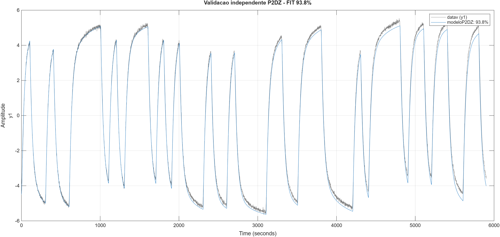
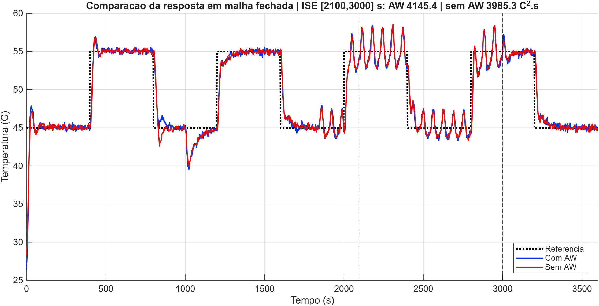

# PRJ1 - Identificação e controle PI discreto

**[Relatório](https://raw.githubusercontent.com/Santana-DS/CDig_PRJ_Grupo10/main/PRJ1/relatorio/CDig_Relatorio_Grupo10_PRJ1.pdf) · [Vídeo - inserir URL](https://www.youtube.com/)**

## Resultado em destaque

O modelo incremental P2DZ obteve 93,8% de ajuste na validação independente e
serviu de base para os projetos PI contínuo e discreto.

O ensaio em malha fechada abaixo compara a realização com e sem anti-windup no
roteiro completo de referências e perturbações.

## Fluxo principal

Execute em `matlab/projeto`, nesta ordem:

1. `Etapa01_Identificacao_P2DZ_V1.m` e
   `Etapa01_Identificacao_P2DZ_V2.m`;
2. `Etapa02_Projeto_PI_Continuo_LGR_P2DZ.m`;
3. `Etapa03_Simulacao_Continua_AW.m`;
4. `Etapa04_Discretizacao_ZOH.m`;
5. `Etapa05_Projeto_PI_Discreto_ZOH.m`;
6. `Etapa06_Simulacao_ZOH_AW.m`.

Os arquivos intermediários são gerados em `resultados/artefatos`. Os scripts
usam os CSVs em `dados` e os modelos em `simulink`, sempre por caminhos
relativos.

O atalho `reproduzir_PRJ1.m` executa a sequência completa. Como as etapas de
projeto abrem o `sisotool` e os modelos Simulink, use-o no MATLAB Desktop.

## Reprodução experimental

- `matlab/reproducao/Etapa00_Coletor_PRBS.py`: coleta da identificação;
- `Etapa08_Monitoramento_Malha_Fechada.m`: acompanhamento em tempo real;
- `Etapa09_Analise_Malha_Fechada_AW.m`: métricas e figuras com/sem
  anti-windup.

Os projetos PlatformIO estão em `firmware/identificacao_prbs` e
`firmware/controle_final`. Compile cada pasta diretamente no PlatformIO.
