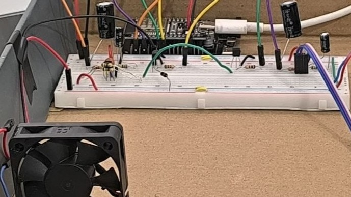
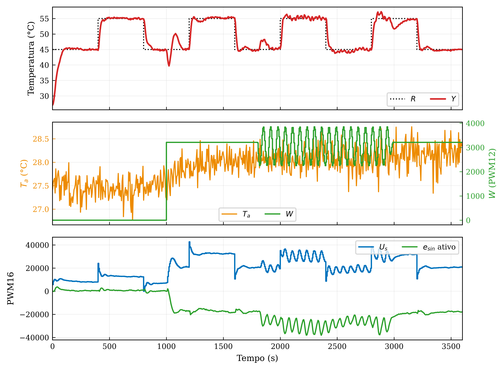

# Controle Digital de Processo Térmico - Grupo 10

Repositório dos projetos PRJ1 e PRJ2 da disciplina ENE0167 - Controle
Digital. O material reúne projeto de controle, firmware da ESP32, modelos
Simulink, dados experimentais e resultados congelados.

**PRJ1:** [Relatório](https://raw.githubusercontent.com/Santana-DS/CDig_PRJ_Grupo10/main/PRJ1/relatorio/CDig_Relatorio_Grupo10_PRJ1.pdf) · [Vídeo - inserir URL](https://www.youtube.com/) 
**PRJ2:** [Relatório](https://raw.githubusercontent.com/Santana-DS/CDig_PRJ_Grupo10/main/PRJ2/relatorio/CDig_Relatorio_Grupo10_PRJ2.pdf) · [Vídeo - inserir URL](https://www.youtube.com/)

## Visão geral

  

A mesma bancada térmica foi usada nos dois projetos. O PRJ1 concentrou-se na
identificação P2DZ e no PI discreto com anti-windup; o PRJ2 acrescentou os
observadores de perturbação e o escalonamento entre os regimes nominal e
ventilado.

### PRJ1 - identificação da planta

O modelo P2DZ alcançou ajuste de validação de 93,8% em dados independentes.

### PRJ2 - controle discreto sob perturbação

O ensaio final de uma hora reúne seguimento de referência, temperatura
ambiente, perturbações constante e senoidal, comando aplicado e compensação do
observador.

## Organização

- `PRJ1/`: identificação P2DZ, projeto PI contínuo/discreto e anti-windup.
- `PRJ2/`: observadores, análise de sensibilidade, identificação sob
  convecção forçada e controle discreto escalonado.
- Em cada projeto, `matlab/projeto` contém a entrega principal e deve ser o
  ponto de partida da avaliação.
- `matlab/reproducao` é um anexo técnico opcional, com coleta, verificações e
  geração de figuras. Ele não acrescenta etapas ao roteiro nem substitui os
  fundamentos apresentados em `matlab/projeto`.
- `dados` e `resultados` preservam as coletas e saídas necessárias para
  reproduzir as análises sem repetir os ensaios físicos.

## Requisitos

- MATLAB R2024b ou posterior;
- Simulink;
- Control System Toolbox;
- System Identification Toolbox;
- Python 3.11+ com `pandas`, `matplotlib` e `pyserial` para os utilitários em
  Python;
- PlatformIO com plataforma `espressif32` para compilar os firmwares.

Todos os caminhos são resolvidos relativamente ao repositório. Após um
`git clone`, não é necessário editar nomes de usuário ou diretórios locais.
A porta serial está configurada como `COM3` nos coletores e pode ser alterada
no início do respectivo arquivo quando a enumeração do sistema for diferente.

Consulte os README de cada projeto para a ordem de execução.
